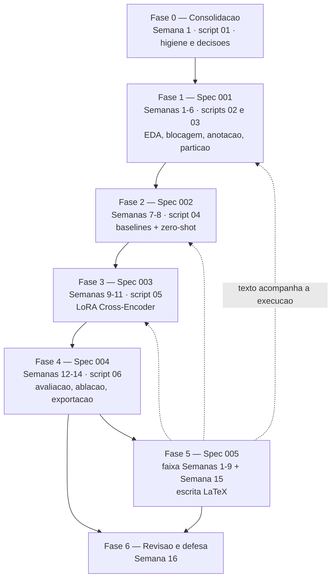

# Plano de Desenvolvimento — TCC Entity Matching com SLMs Fine-Tuned

**Autor:** Pedro Henrique Medeiros Vieira
**Orientador:** Prof. Hilton Martins de Brito Ramalho
**Status:** proposto — aguarda validação do autor e do orientador
**Horizonte:** 16 semanas, execução individual, dedicação parcial
**Última revisão:** 2026-09-17 — varredura de validação independente contra o estado real do repositório (ver §1.0)

---

## 0. Como usar este documento

Este é o plano de execução ponta a ponta, do estado atual do repositório até a defesa. Ele **não reabre** nenhuma decisão registrada em `docs/adr/` nem substitui as `specs/` — ele sequencia, atribui responsáveis e data o que já está decidido, e transforma riscos em tarefas.

Hierarquia de fontes, em caso de conflito:

1. `latex/tcc_artigo/main.tex` — proposta v3 aprovada pelo orientador (objetivos, metodologia, cronograma).
2. `docs/adr/` — decisões arquiteturais derivadas da proposta.
3. `specs/00X-*/requirements.md` — requisitos de implementação por componente.
4. Este plano — sequenciamento e execução.
5. `docs/planejamento_sprint.md` — instanciação semanal. **Uma cópia por semana**, alimentada pelas tarefas deste plano.

Convenção de responsável usada em todas as tarefas:

- **[PEDRO]** — trabalho que só você pode fazer: anotação manual, conversas com orientador/ALTA/Dharma-AI, acesso a infraestrutura, decisões de mérito.
- **[CURSOR]** — trabalho assistido no Cursor: código, testes, análises, geração de tabelas/figuras, redação assistida.
- **[AMBOS]** — trabalho conjunto, tipicamente uma decisão sua sobre um material que o agente prepara.

Marcadores epistêmicos seguem `docs/guia_escrita_cientifica.md`: `[DECISÃO PENDENTE]`, `[RISCO]`, `[PREMISSA]`.

---

## 1. Conflitos e lacunas encontrados — resolver antes de executar

Esta seção existe porque o levantamento do estado real do repositório encontrou divergências entre a proposta v3, os ADRs/specs e o código. **Nenhuma foi resolvida silenciosamente.** Cada item tem dono, prazo sugerido e a fase que ele bloqueia.

### 1.0 — Estado verificado do repositório (2026-09-17)

Linha de base contra a qual os itens abaixo foram conferidos. Tudo aqui foi executado, não inferido:

| Verificação | Resultado |
|---|---|
| `make check` | verde — ruff OK, `mypy scripts/` OK (6 arquivos), pytest **9 passed, 1 xfailed** |
| CI no GitHub Actions | **verde** — run `35257779601`, commit `95ca8fc`, 2026-09-17, status `success` |
| `origin/main` | igual ao `HEAD` local (`95ca8fc`) — nada pendente de push |
| `git status` | só `.gitignore` modificado e este arquivo não rastreado |
| Tags git | **nenhuma** (`git tag -l` vazio) — a tag `proposta-v3` do D14 ainda não existe |
| Scripts implementados | só `01_coleta_dados.py`; `02`–`06` são esqueletos com `NotImplementedError` |
| Artefatos gerados | **nenhum** — `resultados/`, `modelos/` e `dados/processados/` contêm apenas `.gitkeep`/`README.md` |
| `dados/brutos/todos_mercados_2026-09-10.csv` | 30.259 linhas de dados × 13 colunas; 8 `source`, 7 `location`, estados PI/PB/CE |
| `dados/brutos/dicionario_canonico.csv` | **1.593 entradas** de dados (1.594 linhas com cabeçalho; sem quebra de linha final) |
| `referencias.bib` | 15 entradas, todas citadas no `main.tex`, todas na lista auditada da skill `verificacao-citacoes` |
| Diário de pesquisa | uma única entrada (2026-09-17) — nenhuma tarefa deste plano registrada como executada |

**Consequência:** nenhuma tarefa das Fases 0–6 foi concluída desde a redação deste plano, exceto o que está marcado como `✅ RESOLVIDO` nos itens abaixo.

### D1 — `[CRÍTICO]` O dicionário canônico não tem marca nem tamanho, e o protocolo de anotação assume que tem

**Status:** confirmado em 2026-09-17, sem alteração no repositório.

**Evidência.** `dados/brutos/dicionario_canonico.csv` contém entradas do tipo `ARROZ BRANCO`, `ARROZ INTEGRAL`, `ARROZ (POLIDO, PARBOILIZADO, AGULHA, AGULHINHA, ETC)` — produto genérico, **sem marca e sem tamanho**. `main.tex` §4.1 e `dados/brutos/README.md` já registram isso como granularidade confirmada.

**Conflito 1 (documental, barato).** `specs/001-construcao-dataset-ground-truth/requirements.md` ("Regra condicional em aberto"), `docs/protocolo_anotacao.md` §3.4 (e o cabeçalho "Status" do mesmo arquivo) e a skill `.claude/skills/protocolo-anotacao-em/SKILL.md` ainda marcam a granularidade como `[DECISÃO PENDENTE]`. Os dados já responderam: vale o regime "produto genérico", logo **tamanhos diferentes são match**. São quatro lugares a sincronizar, não dois.

**Conflito 2 (metodológico, caro e não registrado em lugar nenhum).** O protocolo foi escrito assumindo entradas canônicas com marca. Sua regra geral (§3.1) exige "mesma marca" e duas de suas regras de não-match (§3.3) são baseadas em marca — "marca própria vs. marca nacional" e "mesma marca, categoria diferente". **Nenhuma delas é aplicável a pares produto × entrada canônica**, porque a entrada canônica não tem marca: qualquer arroz branco de qualquer marca é match de `ARROZ BRANCO`.

**Consequência a decidir.** Para a fatia produto × canônico (secundária desde o ADR-0014), a decisão de match passa a ser essencialmente **de categoria/variante** (branco vs. integral vs. parboilizado), não de marca nem de tamanho. Isso muda o caráter da tarefa: ela se aproxima de classificação em **1.593** categorias genéricas, e se afasta do exemplo de SKU que a proposta usa para ilustrar o problema (`LEITE INTEGRAL ITALAC 1L` vs. `LT ITALAC INTEGRAL 1000ML`). As regras de marca continuam válidas e necessárias **apenas** na fatia suplementar produto × produto (ADR-0007), onde ambos os lados têm marca.

**Conflito 3 (novo, achado na revisão de 2026-09-17).** A tabela de exemplos de heterogeneidade (`latex/tcc_artigo/tabelas/tab_heterogeneidade_exemplos.tex`, único lugar do texto que mostra o dicionário ao leitor) tem uma coluna "Canônico (Dicionário)" preenchida com `Leite Integral Italac 1 Litro`, `Óleo Composto de Soja Liza 900ml`, `Biscoito Maria Bauducco 200g` — ou seja, **entradas canônicas com marca e tamanho, que não existem no dicionário real**. A tabela credita "Fonte: Elaborado pelo autor a partir de dados do projeto ALTA", o que a apresenta como dado real. Isso contradiz diretamente o próprio `main.tex` §4.1 ("uma única entrada ``ARROZ BRANCO'', sem variantes por marca ou tamanho") e é o tipo de inconsistência que a banca encontra. Não é só "recalibrar exemplos": é corrigir uma afirmação factualmente errada sobre os dados. Resolvido pela tarefa 1.1.4 (gerar a tabela a partir da base real), que passa a ser **obrigatória**, não cosmética.

**Decisão necessária [PEDRO + orientador], antes da Semana 3:** reescrever `docs/protocolo_anotacao.md` separando regras por tipo de par, e recalibrar os exemplos de heterogeneidade da Seção 1 do `main.tex`. **Bloqueia:** Fase 1 (anotação).

### D2 — `[CRÍTICO]` Os dados brutos já contêm um matching pré-existente, e essa restrição vive só num README

**Status:** confirmado em 2026-09-17, sem alteração no repositório.

**Evidência.** `dados/brutos/todos_mercados_2026-09-10.csv` tem as colunas `codg_item`, `desc_ref` e `match_score` (verificadas no arquivo: 13 colunas, `match_score` sem nulos) — resultado de um matching heurístico **já aplicado pelo pipeline de produção do ALTA**, independente deste TCC. `dados/brutos/README.md` marca isso como risco de vazamento metodológico e proíbe seu uso na anotação e no treino.

**Lacuna.** Essa proibição não aparece em nenhum ADR, em nenhuma spec, nem no protocolo de anotação. É uma restrição do mesmo calibre das "restrições inegociáveis" do `CLAUDE.md`, mas está registrada apenas num README de dados — não sobrevive a um lapso de memória daqui a oito semanas.

**Decisão necessária [AMBOS], Semana 1:** promover a ADR (ex.: ADR-0010) e adicionar como requisito não funcional com checagem automatizada na spec 001 — a ingestão deve **descartar** essas três colunas, com assert, não por convenção.

**Oportunidade associada.** `match_score` é a evidência mais barata disponível para responder à **recomendação 5 do parecer** (sustentar empiricamente que os métodos clássicos são insuficientes). Reportá-lo na EDA como caracterização do estado atual do ALTA é legítimo; usá-lo como rótulo, não. Decidir explicitamente que esse uso é permitido e onde entra no texto.

### D3 — ✅ RESOLVIDO — o achado de CI do diário está fechado, inclusive no GitHub Actions

**Evidência.** O diário (entrada 2026-09-17) registra como `[ACHADO]` que `Makefile`, `pyproject.toml` e `uv.lock` estavam untracked enquanto o CI dependia deles. O commit `95ca8fc` ("chore: re-track Makefile, pyproject.toml and uv.lock") já resolveu — `git ls-files` confirma os três rastreados e o `.gitignore` tem o comentário explicando a reversão. `make check` passa localmente (ruff + mypy + 9 passed, 1 xfailed).

**Correção da versão anterior deste plano.** A afirmação "o CI nunca rodou desde o re-track" estava **errada**: `gh run list` mostra o run `35257779601` sobre o commit `95ca8fc`, em 2026-09-17, com status `success` em 57s. `origin/main` está em `95ca8fc`, igual ao `HEAD` local — o push já aconteceu e o CI já é verde. A tarefa 0.2.6 nasce concluída; o que resta é manter.

**Resíduo real, único.** `.gitignore` está modificado e não commitado (adicionou `modelo-academico/`). É uma linha; entra no commit de higiene da Fase 0 (tarefa 0.2.3).

**Resíduo novo, relacionado:** ver **D17** — `make check` não replica o CI.

### D4 — O parecer do avaliador não está versionado

**Status:** confirmado em 2026-09-17, sem alteração no repositório.

**Evidência.** `git check-ignore -v` confirma que `.gitignore:107` (`*.pdf`) ignora `docs/parecer/2026-08-15-parecer-avaliador.pdf`, e `git ls-files docs/parecer/` retorna vazio. O arquivo existe só no disco local (205 KB, 2 páginas, PDF impresso do markdown original — não há cópia do `.md` no repositório).

**Problema.** `CLAUDE.md`, ADR-0002 e ADR-0005 citam esse PDF como fonte das revisões pós-parecer. É um documento de avaliação institucional, insubstituível e não regenerável — exatamente o oposto do que a regra `*.pdf` (pensada para PDFs compilados do LaTeX) pretende ignorar.

**Correção [CURSOR], Semana 1:** exceção `!docs/parecer/*.pdf` no `.gitignore` e commit do arquivo.

### D5 — `[CRÍTICO]` O arquivo de anotação — o artefato mais caro do TCC — seria ignorado pelo git

**Status:** confirmado em 2026-09-17, sem alteração no repositório.

**Evidência.** `docs/protocolo_anotacao.md` §5 determina que "o arquivo de anotações é versionado no repositório (`dados/processados/anotacoes.csv` ou equivalente)". Mas `.gitignore:74` ignora `dados/processados/*` (e `.gitignore:75` ignora `dados/brutos/*`, com exceções apenas para `.gitkeep` e `README.md`).

**Problema.** O padrão-ouro custa três semanas de trabalho manual irrecuperável (Semanas 3–5) e é o único insumo que não pode ser regenerado por script. Sem versionamento não há histórico de mudanças de rótulo (que o próprio protocolo exige: "nunca editado retroativamente sem registro de mudança"), nem backup, nem rastreabilidade para o teste-reteste.

**Correção [CURSOR], Semana 1 (antes de qualquer anotação):** exceção `!dados/processados/anotacoes*.csv` no `.gitignore`. Isso resolve sem criar subdiretório novo, respeitando a regra do `AGENTS.md` §2.

**Verificar junto [PEDRO]:** se as descrições brutas do ALTA embutidas no arquivo de anotação podem ser versionadas num repositório que se pretende abrir depois — é a mesma conversa de autorização do D7.

**Nota relacionada (não bloqueante).** `dados/brutos/*` também está ignorado, e o extrato `todos_mercados_2026-09-10.csv` é uma **coleta pontual**, não regenerável por script (`dados/brutos/README.md`). Hoje ele existe só no disco local e no repositório externo do ALTA (`cnpq-precos-etl`). Manter os brutos fora do git é a decisão certa enquanto a autorização do D7-2 estiver aberta, mas vale garantir um backup fora deste repositório antes da Semana 3.

### D6 — A regra "tabelas são geradas pelo script 06, nunca editadas à mão" já é violada, por bom motivo

**Status:** confirmado em 2026-09-17, sem alteração no repositório.

**Evidência.** `AGENTS.md` §4 e `CLAUDE.md` afirmam que tudo em `latex/tcc_artigo/tabelas/` e `figuras/` é gerado pelo script 06. Mas `tab_heterogeneidade_exemplos.tex`, `tab_criterios_selecao_slm.tex`, `tab_cronograma_execucao.tex` e `figuras/fig_pipeline.tex` são escritos à mão e legitimamente não derivam de resultados experimentais. Confirmado por `grep '\input{' main.tex`: são exatamente esses quatro os arquivos importados hoje.

**Além disso**, sobraram cinco tabelas do template de churn, nenhuma referenciada pelo `main.tex` (confirmado pelo mesmo grep): `tab_coeficientes_modelo.tex`, `tab_comparacao_modelos.tex`, `tab_dicionario_dados.tex`, `tab_estatisticas_descritivas.tex`, `tab_matriz_confusao.tex` — todas com conteúdo de churn de clientes (odds ratio, `id_cliente`, matriz de confusão de regressão logística).

**Decisão necessária [AMBOS], Semana 1:** refinar a regra para distinguir **tabelas de resultado** (geradas pelo 06, nunca à mão — é aí que a regra protege contra número digitado errado) de **tabelas de conteúdo qualitativo** (escritas à mão, versionadas normalmente). Remover as cinco sobras do template. Nota: `tab_heterogeneidade_exemplos` **deve migrar** para geração automática pelo script 02, já que passa a extrair exemplos reais da base.

### D7 — As três autorizações formais estão em aberto, sem dono nem prazo

**Status:** confirmado em 2026-09-17, com correção das referências de seção.

`main.tex` carrega **quatro** marcações `[a confirmar]`/`[a levantar]` no total; três delas derivam da **recomendação 3 do parecer** e nenhuma tem ADR, spec ou tarefa:

1. **Dharma-AI** (§6.4 "Alinhamento com o horizonte de pesquisa", linha 370): autorização formal, **por escrito**, para uso da infraestrutura e do Dataset Generator no âmbito do TCC.
2. **ALTA/CNPq + Dharma-AI** (§4.6 "Reprodutibilidade", linha 331): autorização para abrir publicamente o repositório e o conjunto de teste anotado.
3. **Orientador** (§6.4, linha 370, marcador `[a levantar]`): avaliação conjunta do potencial de proteção por patente/registro. O parecer é explícito: **"a decisão sobre o que abrir e quando precisa ser tomada antes da defesa, e não depois."**

A quarta marcação (§4.2 "Formulação e modelo", linha 304, sobre `load_in_4bit`) é o **D9**, tratada à parte. A versão anterior deste plano apontava as marcações 1 e 3 como estando em "§6.3" — §6.3 é a "Hipótese central" e não contém marcador nenhum. Corrigido.

**Ação [PEDRO], Semana 1–2:** as três são caminho crítico para a Fase 5 (o que o texto pode prometer) e para a Fase 6 (defesa). A (3) precisa entrar na pauta da primeira reunião de orientação.

### D8 — `[RISCO]` O gatilho do ADR-0009 vence antes do que o cronograma sugere

**Status:** confirmado em 2026-09-17 — o acoplamento é real e continua sem data.

**Evidência.** O diário registra o acesso à GPU da Dharma-AI como risco aberto. `specs/003/requirements.md` RF1 manda "verificar VRAM disponível no início da execução" do script 05 — Semana 9 pelo cronograma da proposta.

**Problema de acoplamento, não exposto no cronograma da proposta.** A spec 002 exige que o baseline zero-shot use **o mesmo checkpoint-base que será fine-tuned** (RF2, ADR-0008, skill `avaliacao-baselines`: "Nunca substituir por um modelo diferente"). Os baselines rodam nas Semanas 7–8. Logo, se a contingência do ADR-0009 for acionada e o modelo cair para Gemma 2 2B, **o baseline zero-shot da Semana 7 já terá sido rodado com o modelo errado** e precisará ser refeito.

**Consequência.** A decisão LLaMA 3.2 3B vs. Gemma 2 2B tem prazo real de **fim da Semana 6**, não Semana 9. Esse é o gatilho que o ADR-0009 não datou.

**Ação [PEDRO], Semana 1–2 (confirmar) / Semana 6 (gatilho):** confirmar o acesso; se não houver confirmação escrita até o fim da Semana 6, acionar ADR-0009 e congelar o modelo antes de rodar o zero-shot.

### D9 — `load_in_4bit: True` do ambiente de teste continua sem esclarecimento

**Status:** confirmado em 2026-09-17, sem alteração no repositório.

ADR-0003 registra `[a confirmar oficialmente com o time de plataforma da Dharma-AI]` se o `load_in_4bit: True` do `default.yml` reflete restrição de produção não documentada. Se refletir, o ADR-0003 (LoRA bf16 sem quantização) precisa ser revisado. O mesmo marcador está no `main.tex` §4.2 (linha 304) — os dois textos mudam juntos se a resposta vier. Mesma conversa do D8 — **[PEDRO], Semana 1–2**.

### D10 — A spec 003 ainda trata como aberta uma decisão já tomada

**Status:** confirmado em 2026-09-17, sem alteração no repositório.

`specs/003/requirements.md` RF4 diz "W&B ou MLflow — decidir e manter consistente". O diário (2026-09-17) já decidiu **MLflow**, e o `pyproject.toml` já traz `mlflow>=2.14`. A skill `reprodutibilidade-ml` (linha 11) também ainda diz "escolher uma". Correção documental barata — **[CURSOR], Semana 1**.

**Terceiro lugar, achado na revisão:** `main.tex` §4.6 (linha 331) ainda escreve "uma única ferramenta (Weights & Biases ou MLflow)". Como é a proposta aprovada, **não** se corrige agora em silêncio: entra na tarefa 5.3 (proposta → TCC), onde a frase vira o relato do que foi de fato usado.

### D11 — O Dataset Generator não tem contrato documentado

**Status:** confirmado em 2026-09-17, sem alteração no repositório.

`specs/001/requirements.md` RF3 manda "invocar o Dataset Generator (Dharma)", mas nenhum spec ou ADR descreve **como**: biblioteca, CLI, API? Custo/quota? Formato de entrada e saída? `pyproject.toml` não tem dependência correspondente (confirmado: as dependências cobrem 01–04 e 06, mais o extra `finetuning`; nada de Generator). Isso bloqueia a Fase 1 (Semana 6) e é indissociável da autorização do D7-1.

**Ação [PEDRO], Semana 2:** levantar o contrato de uso com a Dharma-AI. **[CURSOR], Semana 2:** documentar como adendo à spec 001 assim que o contrato for conhecido.

### D12 — `cod_padrao` segue sem significado confirmado

**Status:** confirmado em 2026-09-17, com correção dos valores.

`main.tex` §4.1/§4.7 decidiu **não** usar a coluna como sinal de categoria, e por isso não reporta distribuição por categoria nem estratifica por ela. A decisão de não-uso está tomada e é defensável, mas confirmar o significado é barato e destravaria estratificação e blocagem por categoria. **[PEDRO], Semana 1–2**, na mesma conversa com o ALTA do D7-2.

**Correção factual.** `dados/brutos/README.md` descreve a coluna como "10 valores distintos (0–9, 99)" — a leitura direta do CSV dá os valores `1, 2, 3, 4, 5, 6, 7, 8, 9, 99`: são 10 valores distintos, mas **não existe o valor `0`**. A faixa correta é `1–9` mais `99`. Corrigir o README junto com o restante da higiene da Fase 0 (tarefa 0.2.7).

### D13 — Contagens da base: o dicionário está certo; o número de registros está errado por um

**Status:** conferido diretamente em 2026-09-17 — a suspeita original do plano se inverteu.

**Dicionário: ✅ correto, nada a fazer.** A suspeita anterior (que `1.593` fosse contagem de linhas incluindo cabeçalho, logo 1.592 entradas) está **refutada**. O arquivo tem 1.594 linhas contando o cabeçalho e **não termina com quebra de linha** — por isso `wc -l` devolve 1593. A leitura por `csv.reader` confirma **1.593 linhas de dados**. `main.tex` §4.7 e `dados/brutos/README.md` estão corretos.

**Registros: ❌ errado, precisa correção.** O que o levantamento anterior não checou: `main.tex` §4.7 e `dados/brutos/README.md` afirmam **30.260 registros**. O arquivo tem 30.260 **linhas** incluindo o cabeçalho, ou seja, **30.259 registros de dados** (`pandas.read_csv` → `shape (30259, 13)`). É o mesmo erro de off-by-one que se suspeitou do dicionário, cometido no outro arquivo.

**Ação [CURSOR], Semana 1:** corrigir `dados/brutos/README.md` para 30.259 imediatamente (tarefa 0.2.7). O `main.tex` é a proposta aprovada: a correção do número entra na passagem proposta → TCC (tarefa 5.3), com o valor vindo da saída do script 02 (tarefa 1.1.1), não digitado à mão. Números adicionais já conferidos para a EDA: 8 `source` distintos (redes), 7 valores distintos de `location`, distribuição por estado PI 10.909 / PB 10.387 / CE 8.963, 26.016 `product_id` distintos e 28.602 descrições distintas.

### D14 — `main.tex` é hoje a proposta; falta decidir como ela vira o TCC final

**Status:** confirmado em 2026-09-17 — `git tag -l` está vazio, a tag `proposta-v3` não foi criada.

`specs/005/requirements.md` RF1 prevê que o Cronograma "no TCC final vira relato do que foi executado" e que entram Resultados, Discussão e Conclusão. Mas existe um único `main.tex`. Ao mesmo tempo, `CLAUDE.md` declara a proposta v3 "fonte de verdade para objetivos, metodologia e cronograma" — reescrevê-la in-place apaga essa fonte.

**Decisão necessária [PEDRO], Semana 1:** sugestão é criar a tag git `proposta-v3` no commit atual antes de começar a reescrever, preservando o snapshot sem duplicar arquivo nem violar a regra de documento único do `AGENTS.md` §4.

### D15 — `make pipeline` não roda em máquina sem GPU (e hoje nem chega lá)

**Status:** confirmado em 2026-09-17, com correção do ponto de falha.

O target `pipeline` encadeia `coleta eda construir-dataset baselines finetuning avaliar` (Makefile:83), incluindo o script 05, que exige GPU. `AGENTS.md` §2 promete scripts "executáveis ponta a ponta com `make pipeline`", e §3 exige um teste de integração leve que verifique "a passagem de artefatos 01→06".

**Correção da versão anterior:** hoje `make pipeline` **não falha na etapa 05 — falha na 02**, porque `02_analise_exploratoria.py` levanta `NotImplementedError` (assim como 03, 04, 05 e 06). O problema de GPU é real, mas só se manifesta a partir da Semana 9. Até lá, o alvo `pipeline` fica vermelho por implementação faltante, o que é esperado e está documentado pelo xfail estrito em `tests/test_integracao_pipeline.py`. A decisão abaixo continua necessária, mas **não é urgente na Semana 1** — o prazo real é o fim da Fase 2 (Semana 8), antes de o script 05 existir.

**Decisão necessária [AMBOS], até o fim da Semana 8:** ou o script 05 detecta ausência de GPU e pula com aviso (mantendo `make pipeline` verde em qualquer máquina), ou `pipeline` exclui o 05 e passa a existir um `pipeline-full`. De qualquer forma, o teste de integração 01→06 não pode depender de GPU. Hoje esse teste cobre só o script 01 mais um xfail do 02 — ele cresce junto com cada fase, não no fim.

### D16 — A redação incremental não cabe no modelo "uma fase por spec"

**Status:** confirmado em 2026-09-17.

A proposta (§5, "Redação incremental") distribui Introdução, Revisão e Metodologia pelas Semanas 1–9, com checkpoint de 60% do texto na Semana 8 — e o parecer destacou isso como ponto forte ("é uma boa ideia que evita se empolgar na parte boa"). A spec 005 não menciona esse faseamento. Por isso, **a Fase 5 deste plano é modelada como faixa transversal** que corre em paralelo às Fases 1–3, mais uma fase de fechamento na Semana 15. Não é uma fase sequencial no fim.

### D17 — `[NOVO]` `make check` não replica o CI, apesar de os dois docs dizerem que sim

**Evidência.** `CLAUDE.md` e `AGENTS.md` §5 descrevem `make check` como "lint + typecheck + testes (mesmo do CI)". Mas o alvo `check` (Makefile:272) roda `lint typecheck test`, e `lint` (Makefile:240) roda apenas `ruff check`. O CI (`.github/workflows/ci.yml`) roda um passo a mais: `ruff format --check scripts/ tests/`.

**Consequência.** Um arquivo mal formatado passa no `make check` local e quebra o CI — foi exatamente esse tipo de divergência que já produziu os commits `4a8ed81` ("style: run pre-commit to fix formatting for CI") e `ceb6ae7`. Hoje não há sintoma (`ruff format --check` reporta "11 files already formatted"), o que torna a correção barata.

**Correção [CURSOR], Semana 1:** acrescentar `ruff format --check` ao alvo `lint` (ou um alvo `format-check` encadeado em `check`). Tarefa 0.2.8.

### D18 — `[NOVO]` Sobras do template de churn fora do `latex/`, e um parágrafo do `AGENTS.md` que ficou obsoleto

O D6 pegou as cinco tabelas órfãs. A varredura de 2026-09-17 encontrou mais três resíduos da mesma origem:

1. **`scripts/README.md`** ainda documenta integralmente o pipeline de churn do template: diagrama com `03_preprocessamento.py`, `04_treinamento_modelo.py`, `05_avaliacao_modelo.py`, `06_exportar_figuras_eps.py`, e uma tabela de I/O com `dataset_clientes.csv` e `modelos/*.joblib`. Nenhum desses arquivos existe mais — os scripts foram renomeados no commit `970354a`.
2. **`AGENTS.md` §2** diz: "Os arquivos no disco ainda podem usar nomes do template (`03_preprocessamento.py`, ...). Isso é dívida de adaptação". Essa dívida **já foi paga** por `970354a`; o parágrafo agora descreve um estado que não existe e confunde quem chega.
3. **`dados/brutos/README.md`** abre com uma seção "Dataset de Demonstração" descrevendo `dataset_clientes.csv` (churn de telecom, 1.000 registros) como "o dataset padrão deste repositório", antes de chegar aos dados reais do ALTA. Também carrega, no fim, o "Template de Documentação de Dados" do repo-modelo.

**Por que importa.** O `pipeline-python.mdc` do Cursor já precisa dizer explicitamente "não o `scripts/README.md` do template" — a documentação errada está ativamente custando atenção. É higiene barata, mesmo lote da 0.2.

**Correção [CURSOR], Semana 1:** tarefa 0.2.9.

### D19 — `[NOVO]` Erratas documentais pequenas

Achadas na varredura, todas de custo quase zero e agrupadas na tarefa 0.2.7:

- `dados/brutos/README.md` remete a autorização de abertura dos dados para "`main.tex`, §4.5" — a subseção "Reprodutibilidade" é a **§4.6**; a §4.5 é "Pipeline progressivo".
- `docs/protocolo_anotacao.md` §2 contém dois caracteres CJK espúrios (`核心`) no meio de uma frase em português: "**Produto × Entrada canônica** (核心, ~250–450 pares)". O protocolo é artefato citado pelo `main.tex` §4.1 e será auditado pela banca.
- `dados/brutos/README.md`: contagem de registros (D13) e valores de `cod_padrao` (D12).

---

## 2. Visão geral das fases

Dependência dura entre fases: cada script consome a saída do anterior (`AGENTS.md` §2). A Fase 2 não pode começar sem o conjunto de teste da Fase 1; a Fase 4 não pode começar sem o modelo da Fase 3; a Fase 5 de fechamento não pode começar sem os artefatos exportados pela Fase 4.

---

## Fase 0 — Consolidação e destravamento

**Semana 1** · Script `01_coleta_dados.py` (já implementado) · Sem spec própria

### Objetivo
Zerar a dívida documental e de infraestrutura, e disparar as conversas de longo lead time (autorizações, GPU, ALTA) para que nenhuma delas seja caminho crítico depois.

### Pré-requisitos
Nenhum. É a fase de entrada.

### Tarefas

**0.1 — Resolver os conflitos documentais D1 (parte 1), D2, D10 [AMBOS]**
- 0.1.1 [CURSOR] Atualizar `specs/001/requirements.md`: substituir a "Regra condicional em aberto" pelo regime confirmado (produto genérico → tamanhos diferentes são match), citando a evidência em `dados/brutos/dicionario_canonico.csv`. Sincronizar os outros três lugares que ainda dizem `[DECISÃO PENDENTE]`: `docs/protocolo_anotacao.md` (cabeçalho "Status" e §3.4) e a skill `protocolo-anotacao-em` — a reescrita de mérito do protocolo é a tarefa 1.3, esta é só a marcação.
- 0.1.2 [CURSOR] Atualizar `specs/003/requirements.md` RF4 e a skill `reprodutibilidade-ml` (linha 11): MLflow, decidido, sem alternativa em aberto. O `main.tex` §4.6 fica para a tarefa 5.3 (é a proposta aprovada, não se edita agora).
- 0.1.3 [AMBOS] Redigir ADR-0010 sobre as colunas `codg_item`/`desc_ref`/`match_score` como vazamento proibido; adicionar requisito não funcional com assert na spec 001.
- 0.1.4 [PEDRO] Aprovar os três antes do commit.

**0.2 — Higiene de repositório: D3, D4, D5, D6, D12, D13, D17, D18, D19 [CURSOR, aprovação PEDRO]**
- 0.2.1 Exceção `!docs/parecer/*.pdf` no `.gitignore` e commit do parecer.
- 0.2.2 Exceção `!dados/processados/anotacoes*.csv` no `.gitignore` — **obrigatoriamente antes da Semana 3**.
- 0.2.3 Commitar a alteração pendente do `.gitignore` (`modelo-academico/`).
- 0.2.4 Remover as cinco tabelas órfãs do template de churn em `latex/tcc_artigo/tabelas/`.
- 0.2.5 Refinar a regra do `AGENTS.md` §4 distinguindo tabela de resultado (gerada) de tabela de conteúdo (à mão).
- 0.2.6 ✅ **CONCLUÍDO antes da redação deste plano.** O push já foi feito e o CI já rodou verde (run `35257779601`, commit `95ca8fc`, 2026-09-17). Permanece como rotina, não como tarefa: `make check` antes de cada commit e CI verde após cada push (ver §5).
- 0.2.7 **[NOVO]** Corrigir as erratas do D12/D13/D19 em `dados/brutos/README.md` (30.259 registros; `cod_padrao` = `1–9` e `99`, sem `0`; referência cruzada §4.5 → §4.6) e o caractere espúrio `核心` em `docs/protocolo_anotacao.md` §2.
- 0.2.8 **[NOVO, D17]** Acrescentar `ruff format --check scripts/ tests/` ao alvo `lint` do `Makefile`, de modo que `make check` passe a ser de fato o que o CI roda. Validar rodando `make check` e comparando com os passos do `ci.yml`.
- 0.2.9 **[NOVO, D18]** Reescrever `scripts/README.md` para o pipeline real de EM (01–06, specs correspondentes); remover o parágrafo obsoleto de "dívida de adaptação" do `AGENTS.md` §2; podar a seção "Dataset de Demonstração" e o "Template de Documentação de Dados" do `dados/brutos/README.md`.

**0.3 — Decisões de estrutura: D14, D15 [AMBOS]**
- 0.3.1 [PEDRO] Decidir a estratégia de versionamento proposta → TCC final; se for a tag, [CURSOR] cria `proposta-v3`. **Verificado:** nenhuma tag existe hoje.
- 0.3.2 [AMBOS] Decidir o comportamento de `make pipeline` sem GPU e registrar no `AGENTS.md`. **Reprazado para o fim da Semana 8** (ver D15 revisado): hoje o pipeline para na etapa 02 por implementação faltante, não por GPU. Decidir na Semana 1 seria decidir no vácuo.

**0.4 — Abrir as conversas de longo prazo: D7, D8, D9, D11, D12 [PEDRO]**
- 0.4.1 Dharma-AI: pedir por escrito a autorização de uso da infra + Dataset Generator; confirmar acesso à GPU e o tier disponível; esclarecer o `load_in_4bit`; levantar o contrato de uso do Generator.
- 0.4.2 ALTA/CNPq: confirmar o significado de `cod_padrao` e a política de abertura dos dados/conjunto de teste.
- 0.4.3 Orientador: agendar R1 e incluir na pauta a conversa de propriedade intelectual (exigida pelo parecer **antes** da defesa).

### Critérios de aceite
- [ ] Nenhum `[DECISÃO PENDENTE]` remanescente em specs/protocolo/skills que já tenha sido respondido pelos dados.
- [x] `make check` verde localmente **e** CI verde num push ao `origin/main` — verificado em 2026-09-17 (run `35257779601`). Reconfirmar após o commit de higiene.
- [ ] `make check` executa exatamente os mesmos passos do `ci.yml` (D17).
- [ ] Parecer do avaliador versionado no git.
- [ ] `.gitignore` permite versionar o arquivo de anotação.
- [ ] Nenhum documento do repositório descreve o pipeline de churn do template (D18).
- [ ] As três autorizações do D7 com pedido formalmente enviado (não necessariamente respondido).

### Riscos
- `[RISCO]` As respostas da Dharma-AI e do ALTA têm lead time fora do seu controle. Enviar tudo na Semana 1 é o que garante que a resposta chegue antes do gatilho da Semana 6 (D8).

---

## Fase 1 — Construção do dataset e ground truth (spec 001)

**Semanas 1–6** · Scripts `02_analise_exploratoria.py` e `03_construcao_dataset.py` · ADRs 0004, 0005, 0006, 0007

### Objetivo
Produzir partições treino/validação/teste sem vazamento, combinando geração assistida (treino) e anotação manual independente (teste), a partir de dados reais do ALTA.

Esta é a fase de **caminho crítico** reconhecida pelo parecer: "qualquer deslize nesse trecho se propaga por todo o restante do cronograma". A regra da proposta é explícita — atrasos são absorvidos pela ablação (Semana 13), **nunca** pela anotação nem pela redação.

### Pré-requisitos
- Fase 0 concluída, em especial 0.1 (regra de granularidade), 0.2.2 (versionamento da anotação) e 0.4.1 (contrato do Generator, para a Semana 6).
- `dados/brutos/` validado pelo script 01 — já funciona hoje (verificado: `make check` verde, teste de integração do 01 passando em `tmp_path`).

`[DESVIO DECLARADO DA PROPOSTA]` O cronograma aprovado coloca "definição do protocolo de anotação" na Semana 1. O protocolo já existe desde 2026-08-13; o que a Semana 2 faz (tarefa 1.3) é **revisá-lo** à luz do D1. Como a anotação só começa na Semana 3, o desvio não consome folga — mas se a revisão não fechar até o fim da Semana 2, ela vira caminho crítico.

### Tarefas

**1.1 — Análise exploratória (Semana 1) [CURSOR implementa, PEDRO interpreta]**

Implementa `scripts/02_analise_exploratoria.py`, hoje esqueleto com `NotImplementedError`. Responde diretamente à observação do parecer §2 ("a caracterização quantitativa da base é ainda planejada, e não realizada... tem baixo custo e alto retorno").

- 1.1.1 Números exigidos pelo `main.tex` §4.7: total de registros (**30.259 — corrige o 30.260 do texto, ver D13**); nº de estabelecimentos e distribuição por PB/CE/PI; nº de entradas do dicionário (**1.593, já conferido — o texto está correto**); taxa estimada de sobreposição de produtos entre lojas. Valores já apurados na revisão de 2026-09-17 e que o script deve reproduzir: 8 redes (`source`), 7 valores de `location`, PI 10.909 / PB 10.387 / CE 8.963, 26.016 `product_id` distintos, 28.602 descrições distintas.
- 1.1.2 Caracterização do ruído de PDV por tipo (abreviação, inversão de ordem, unidade, tipografia) — é o insumo da taxonomia de erro da Fase 4 e precisa ser definida agora, não depois.
- 1.1.3 Distribuição de `match_score` do ETL do ALTA como caracterização do estado atual (**D2**, uso permitido como contexto, proibido como rótulo).
- 1.1.4 `[CRÍTICO]` Gerar `tab_heterogeneidade_exemplos.tex` a partir de exemplos reais da base, substituindo a versão escrita à mão (**D6**). Não é cosmético: a coluna "Canônico (Dicionário)" da versão atual mostra entradas com marca e tamanho que **não existem** no dicionário real e contradizem o próprio `main.tex` §4.1 (**D1 conflito 3**).
- 1.1.5 Saídas em `resultados/metricas/` e `resultados/figuras/`, conforme `AGENTS.md` §2 e o docstring do script 02 — a spec 001 não fixa caminhos de saída para a EDA.
- 1.1.6 Testes nas três camadas do `AGENTS.md` §3; matplotlib em backend `Agg`.
- 1.1.7 [PEDRO] Ler os números e decidir se algum contradiz a proposta.

**1.2 — Blocagem e geração de candidatos (Semana 2) [CURSOR]** — *revisado em 2026-10-31: dividido em **1.2a** (produto × dicionário, concluída em 2026-10-31: TF-IDF, k=20; fatia secundária pelo ADR-0014) e **1.2b** (produto × produto entre lojas; **fatia principal, próxima tarefa, caminho crítico** — ADR-0014); recall medido numa **amostra cega** de ~50 produtos (ADR-0006, emenda); ver o log da §6.*
- 1.2.1 TF-IDF e BM25 sobre o dicionário canônico (ADR-0006), com `rank-bm25` e `scikit-learn` já no `pyproject.toml`.
- 1.2.2 **Registrar o recall da blocagem isoladamente** (fração de vezes que o candidato correto está no top-k **antes** do reranqueamento) — requisito não funcional da spec 001 e insumo obrigatório da spec 004.
- 1.2.3 Varredura de k para escolher o ponto de operação, com o trade-off documentado.
- 1.2.4 Supervisão distante: pares com correspondência de marca + unidade normalizada recebem rótulo provisório. **Atenção ao D1**: como o dicionário não tem marca, a heurística precisa ser reformulada em termos de categoria/variante para a fatia produto × canônico.
- 1.2.5 Código de blocagem escrito uma vez e reutilizado pelas specs 002/003/004 — a skill `avaliacao-baselines` proíbe comparar métodos com blocagens diferentes.
- 1.2.6 Seed fixa; configuração em YAML versionado, não hardcoded.

**1.3 — Revisar o protocolo de anotação (Semana 2) [PEDRO decide, CURSOR redige]**

Resolve o **D1 conflito 2**, o item de maior risco metodológico do plano.
- 1.3.1 Separar as regras por tipo de par: produto × canônico (categoria/variante; sem marca; sem tamanho) e produto × produto (regras atuais, incluindo marca e kit/promoção).
- 1.3.2 Remover a estrutura de duplo rótulo da §3.4, que existia só para a pendência agora resolvida.
- 1.3.3 Revisar os exemplos de referência rápida da §6, hoje todos em regime de SKU com marca.
- 1.3.4 [PEDRO] Validar com o orientador na R1.
- 1.3.5 [CURSOR] Sincronizar a skill `protocolo-anotacao-em`.

**1.4 — Anotação manual do padrão-ouro (Semanas 3–5) [PEDRO, exclusivamente]**

Trabalho indelegável. O agente **não pode** rotular pares de teste — ADR-0004 e a restrição inegociável do `CLAUDE.md`.
- 1.4.1 [CURSOR] Preparar a planilha de anotação a partir dos candidatos da 1.2, com os campos exigidos pelo protocolo §5 (id, texto A, texto B, tipo de par, metadados de unidade, rótulo, timestamp, flag de teste-reteste). Amostragem com seed fixa e registrada.
- 1.4.2 [PEDRO] Anotar os pares produto × entrada canônica (fatia secundária, ADR-0014; tamanho a redefinir, menor que os ~250–450 originais).
- 1.4.3 [PEDRO] Anotar os pares produto × produto (fatia principal, ADR-0014; tamanho a definir — D-13; os ~50–100 originais provavelmente não bastam).
- 1.4.4 [PEDRO] Marcar casos indecidíveis como `incerto`; adjudicar por consulta ao dicionário oficial ou ao ALTA. Pares `incerto` não resolvidos não entram no teste.
- 1.4.5 [PEDRO] Commitar o arquivo de anotação periodicamente — o versionamento destravado em 0.2.2 é o que dá backup a três semanas de trabalho.
- 1.4.6 [CURSOR] Validador de consistência: schema, rótulos fora do domínio, duplicatas, pares com ambos os lados idênticos. Valida forma, **nunca** mérito do rótulo.

**1.5 — Teste-reteste (Semana 5–6) [PEDRO anota, CURSOR calcula]**

ADR-0005. O intervalo de **≥7 dias** é inegociável e precisa ser respeitado no calendário: a primeira passagem do subconjunto tem que acontecer cedo o bastante na Semana 3–4 para o reteste caber na Semana 5–6.

`[DESVIO DECLARADO DA PROPOSTA]` O cronograma aprovado (`tab_cronograma_execucao.tex`) coloca anotação **e** teste-reteste dentro das Semanas 3–5. Este plano empurra a segunda passagem para as Semanas 5–6, porque com anotação terminando na Semana 5 o intervalo de ≥7 dias não cabe dentro da própria janela. O desvio é de calendário, não de método, e não desloca o marco M1 (fim da Semana 6). Registrar no diário e mencionar na R2; se o orientador preferir manter o cronograma literal, a alternativa é fechar a primeira passagem do subconjunto de reteste já na Semana 3.
- 1.5.1 [CURSOR] Sortear ≥50% do conjunto de teste, com seed registrada, e emitir a planilha de reteste **sem os rótulos originais**.
- 1.5.2 [PEDRO] Reanotar às cegas.
- 1.5.3 [CURSOR] Calcular Cohen's Kappa entre as duas passagens.
- 1.5.4 [AMBOS] Se Kappa < 0,75: revisar as regras da §3 do protocolo (o protocolo aponta "regras ambíguas ou mal-aplicadas" como fonte provável) antes de fechar o teste. **Reportar o valor de qualquer forma, com discussão** — é critério de aceite da spec 001.

**1.6 — Partição anti-vazamento (Semana 6) [CURSOR]**
- 1.6.1 Particionamento estratificado **por produto canônico**, 70/15/15, com seed fixa: todos os pares de um dado produto do dicionário ficam integralmente numa única partição.
- 1.6.2 `[CRÍTICO]` A partição acontece **antes** de qualquer geração ou aumentação. Não é ordem de conveniência — é a restrição que sustenta a Seção 4 inteira da proposta.
- 1.6.3 Assert explícito no script: nenhum produto do teste aparece na base que alimenta o Generator. Checagem automatizada, não convenção (requisito `[CRÍTICO]` da spec 001).

**1.7 — Geração de treino e aumentação (Semana 6) [CURSOR, dependente de PEDRO]**
- 1.7.1 **Bloqueado por D11 e D7-1.** Se o contrato do Generator ou a autorização não estiverem resolvidos, esta tarefa é o gargalo da fase.
- 1.7.2 Invocar o Dataset Generator sobre as entradas reais do dicionário — paráfrases e variações, nunca substituindo os dados reais como fonte de rótulo.
- 1.7.3 Versionar o conjunto gerado como artefato (`main.tex` §4.6: chamadas de LLM podem não ser determinísticas, então o artefato é o que garante reprodutibilidade).
- 1.7.4 Aumentação sintética por perturbação de tokens (abreviação, troca de unidade, inversão de ordem) **somente no treino, após a partição**.
- 1.7.5 Rodar novamente o assert da 1.6.3 depois da geração.

### Critérios de aceite (reproduzidos da spec 001)
- [ ] Partições treino/val/teste versionadas, sem sobreposição de produto canônico entre elas.
- [ ] Conjunto de teste por fatia: produto × produto (principal) e produto × dicionário (secundária), com tamanhos a definir (ADR-0014).
- [ ] Kappa de teste-reteste calculado sobre ≥50% do conjunto de teste (ADR-0005), reportado mesmo se abaixo de 0,75 (com discussão).
- [ ] Nenhum produto do teste presente na base usada pelo Dataset Generator (checagem automatizada, não manual).

### Riscos e decisões que condicionam a fase
- `[RISCO ALTO]` **D1** não resolvido antes da Semana 3 → anotação feita sob regras inaplicáveis, retrabalho de três semanas.
- `[RISCO ALTO]` **D5** não resolvido antes da Semana 3 → padrão-ouro sem versionamento nem backup.
- `[RISCO MÉDIO]` **D11/D7-1** não resolvidos até a Semana 6 → geração de treino travada. Mitigação: começar por supervisão distante + aumentação sintética, que não dependem do Generator, e incorporá-lo quando destravar.
- `[RISCO MÉDIO]` Kappa < 0,75 exige revisão de regras e reanotação parcial. Mitigação: calcular o Kappa num piloto de ~50 pares já na Semana 3, em vez de descobrir na Semana 6.
- `[RISCO]` Volume de anotação subestimado. Mitigação: a proposta dava a faixa 300–500 para produto × dicionário; com o ADR-0014 o esforço migra em parte para produto × produto, e os tamanhos por fatia precisam ser fixados antes de anotar.

---

## Fase 2 — Baselines clássicos e zero-shot (spec 002)

**Semanas 7–8** · Script `04_baselines.py` · ADRs 0002, 0006, 0008

### Objetivo
Estabelecer o piso de comparação obrigatório **antes** de qualquer modelo especializado, com protocolo de avaliação congelado e reutilizado por todos os métodos subsequentes. O parecer destacou essa antecipação como ponto forte da proposta — a ordem importa.

### Pré-requisitos
- Conjunto de teste e blocagem da Fase 1 fechados.
- `[BLOQUEANTE]` **D8 decidido**: o modelo-base precisa estar congelado antes da tarefa 2.2, senão o zero-shot roda com o checkpoint errado.

### Tarefas

**2.1 — Harness de avaliação congelado (Semana 7) [CURSOR]**

Escrito **uma vez** aqui e reutilizado sem duplicação pelas specs 003 e 004.
- 2.1.1 Precision, Recall, F1 para a decisão binária.
- 2.1.2 MRR e Recall@K pós-blocagem, com as definições exatas da skill `avaliacao-baselines`: Recall@K mede se o match verdadeiro está entre os k candidatos **após** o reranqueamento; o recall da blocagem isolada (1.2.2) é reportado separadamente.
- 2.1.3 Fatia produto × produto avaliada e reportada **separadamente** da fatia produto × canônico — nunca misturadas na mesma tabela sem rótulo claro.
- 2.1.4 Testes unitários do harness com casos de borda conhecidos. Erro de métrica aqui contamina tudo o que vem depois.

**2.2 — Cinco baselines clássicos (Semana 7) [CURSOR]**
- 2.2.1 TF-IDF, BM25, Levenshtein, Jaccard, embeddings genéricos (sem fine-tuning).
- 2.2.2 Mesma blocagem da Fase 1 para todos.
- 2.2.3 Seed fixa; tabela reprodutível.

**2.3 — LLaMA 3.2 3B zero-shot (Semana 8) [CURSOR implementa, PEDRO provê acesso]**
- 2.3.1 **Mesmo checkpoint-base** que será fine-tuned na Fase 3 (ADR-0002/0008). A skill é explícita: nunca substituir por outro modelo, sob pena de confundir tamanho de modelo com efeito de especialização.
- 2.3.2 Prompt estruturado para decisão match/não-match, versionado como artefato — é hiperparâmetro, não detalhe.
- 2.3.3 [PEDRO] Garantir acesso ao modelo (licença LLaMA Community, download de pesos, infra de inferência).

**2.4 — Fechar a lacuna da recomendação 5 do parecer (Semana 8) [AMBOS]**
- 2.4.1 O `main.tex` §1 tem hoje um marcador explícito: "[resultado sumário dessa análise a inserir durante a execução (Seção 4.4)]". Os números da 2.2 fecham isso.
- 2.4.2 [PEDRO] Se os baselines clássicos saírem **melhores** do que a proposta antecipa, a afirmação da Seção 1 precisa ser reescrita honestamente — o parecer pediu exatamente isso ("a afirmação deve ser reapresentada como hipótese a ser testada").

### Critérios de aceite (reproduzidos da spec 002)
- [ ] Tabela comparativa reprodutível (mesmo seed, mesmo conjunto de teste) para os 6 métodos (5 clássicos + zero-shot).
- [ ] Recall@K reportado junto ao recall da blocagem isolada (spec 001), para diferenciar erro de blocagem de erro de ranqueamento.

### Riscos
- `[RISCO ALTO]` **D8**: modelo-base não congelado → zero-shot refeito, perda de uma semana no ponto mais apertado do cronograma.
- `[RISCO]` Se os baselines já resolverem o problema com F1 alto, a hipótese central perde margem. Não é falha do trabalho — é resultado, e o parecer já abriu essa porta. Discutir na R3.
- `[RISCO]` Inferência zero-shot sobre centenas de pares tem custo de GPU/tempo não trivial. Estimar na Semana 7, não na 8.

---

## Fase 3 — Fine-tuning do Cross-Encoder (spec 003)

**Semanas 9–11** · Script `05_finetuning.py` · ADRs 0001, 0002, 0003, 0009

### Objetivo
Fine-tuning supervisionado do SLM para classificação binária de pares, sob a formulação de Cross-Encoder, via LoRA em bf16.

### Pré-requisitos
- Partições da Fase 1 e harness da Fase 2 prontos.
- `[BLOQUEANTE]` Acesso a GPU confirmado **ou** ADR-0009 acionado (D8), decidido desde o fim da Semana 6.

### Tarefas

**3.1 — Configuração do ambiente (Semana 9) [PEDRO provê, CURSOR implementa]**
- 3.1.1 Verificação de VRAM no início da execução; se inferior ao documentado (48–141 GB), acionar ADR-0009 **antes** de prosseguir (spec 003 RF1).
- 3.1.2 `uv sync --extra finetuning` — o extra já está no `pyproject.toml`.
- 3.1.3 MLflow configurado (D10); tracking local ou servidor, decidido aqui e mantido até a Fase 4.
- 3.1.4 Hiperparâmetros em YAML versionado, **nunca hardcoded** (skill `reprodutibilidade-ml`).

**3.2 — Formatação e mineração de negativos (Semana 9) [CURSOR]**
- 3.2.1 Formatar os pares no mesmo formato usado depois na avaliação (spec 003 RF2) — divergência aqui produz resultado silenciosamente errado.
- 3.2.2 Mineração de negativos difíceis: não-match textualmente muito similares (mesma categoria, marcas diferentes), mais informativos que negativos aleatórios.
- 3.2.3 Guardar a versão **sem** negativos difíceis e a versão **sem** aumentação — são os dois braços da ablação da Fase 4. Preparar agora evita retrabalho depois.

**3.3 — Smoke test (Semana 9) [CURSOR]**
- 3.3.1 Pipeline de treino roda ponta a ponta num subconjunto pequeno antes do treino completo. É critério de aceite da spec 003, não opcional.

**3.4 — Treino e ajuste (Semanas 10–11) [CURSOR executa, PEDRO acompanha]**
- 3.4.1 LoRA em bf16, sem quantização de 4 bits (ADR-0003), salvo revisão vinda do D9.
- 3.4.2 Ajuste de hiperparâmetros com orçamento de experimentos definido a priori.
- 3.4.3 Curvas de treino e checkpoints registrados, cada um associado ao config que o gerou.
- 3.4.4 Avaliação com **o harness da Fase 2**, sem uma linha de métrica reescrita.
- 3.4.5 Treinar também os dois braços de ablação da 3.2.3.

### Critérios de aceite (reproduzidos da spec 003)
- [ ] Pipeline de treino executa de ponta a ponta em um subconjunto pequeno antes do treino completo (smoke test).
- [ ] Modelo treinado avaliado com o mesmo harness da spec 002 (nenhum código de métrica duplicado).
- [ ] Configuração de treino registrada de forma que o experimento seja reproduzível a partir do config sozinho.

### Riscos
- `[RISCO ALTO]` **D8/D9** não resolvidos → fase travada no ponto de maior custo de recuperação. O ADR-0009 garante viabilidade do cronograma sob qualquer mitigação, mas só se acionado a tempo.
- `[RISCO]` Overfitting com conjunto de treino de escala moderada. Mitigação: validação da Fase 1 + early stopping; a escala moderada é premissa declarada da hipótese central.
- `[RISCO]` Estouro de orçamento de GPU. Mitigação: fixar o número de runs antes de começar; MLflow torna comparável o que já rodou.

---

## Fase 4 — Avaliação, ablação e exportação (spec 004)

**Semanas 12–14** · Script `06_avaliacao_exportacao.py` · ADRs 0006, 0007, 0008

### Objetivo
Consolidar avaliação comparativa, testes estatísticos, ablação, validação da subtarefa intra-base e análise de erro; exportar todos os artefatos para `latex/tcc_artigo/`.

### Pré-requisitos
Fases 2 e 3 concluídas. Esta é a fase que a proposta designa como **amortecedor de atraso**: se algo escorregou antes, é a ablação (Semana 13) que encolhe — nunca a anotação nem a redação.

### Tarefas

**4.1 — Comparação e significância (Semana 12) [CURSOR]**
- 4.1.1 Cross-Encoder fine-tuned vs. os 6 baselines, todos sobre o mesmo teste pareado.
- 4.1.2 Teste de McNemar para cada par de comparação (ADR-0008).
- 4.1.3 **Tamanho de efeito e IC sempre**, independentemente do p-valor — nunca reportar só p-valor. Com N=300–500, diferenças pequenas podem não atingir significância sem que isso invalide a direção do efeito.
- 4.1.4 [PEDRO] Interpretar o resultado frente à hipótese central, inclusive se for negativo.

**4.2 — Fatia produto × produto (Semana 12) [CURSOR]**
- 4.2.1 Avaliação separada, demonstrando generalização do mesmo modelo **sem retreino** (ADR-0007).
- 4.2.2 Recall@K dessa fatia reportado separadamente da fatia com dicionário.
- 4.2.3 Registrar no texto a limitação da inferência transitiva (ADR-0007: o match inferido herda o erro de cada matching individual).

**4.3 — Ablação (Semana 13) [CURSOR]**
- 4.3.1 Impacto da aumentação sintética.
- 4.3.2 Impacto da mineração de negativos difíceis.
- 4.3.3 Reaproveitar os braços já treinados na 3.2.3/3.4.5.

**4.4 — Pipeline progressivo (Semana 13) [CURSOR]**
- 4.4.1 Limiar de confiança sobre o baseline lexical mais forte (TF-IDF ou BM25).
- 4.4.2 Análise **pós-hoc sobre as saídas já geradas**, sem novo treinamento (spec 004 RF4).
- 4.4.3 Medir fração de pares resolvida pelo método barato, economia computacional e eventual perda de acurácia.

**4.5 — Análise de erro (Semana 14) [CURSOR propõe, PEDRO valida]**
- 4.5.1 Taxonomia por tipo de ruído (abreviação, unidade, marca, categoria), reaproveitando a caracterização da 1.1.2.
- 4.5.2 Pelo menos um exemplo real por categoria.
- 4.5.3 [PEDRO] Validar qualitativamente — a categorização de erro é julgamento de domínio, não classificação automática.

**4.6 — Exportação para LaTeX (Semana 14) [CURSOR]**
- 4.6.1 Todas as tabelas e figuras direto para `latex/tcc_artigo/tabelas/` e `figuras/`.
- 4.6.2 Escapes LaTeX preservados nas strings exportadas do Pandas (`AGENTS.md` §4).
- 4.6.3 **Nenhum número digitado à mão no `.tex`** — critério de aceite da spec 005.

### Critérios de aceite (reproduzidos da spec 004)
- [ ] Tabela comparativa final com McNemar, effect size e IC para cada baseline vs. Cross-Encoder.
- [ ] Recall@K da fatia sem dicionário reportado separadamente da fatia com dicionário.
- [ ] Economia computacional do pipeline progressivo quantificada (% de pares resolvidos sem SLM, tempo/custo poupado).
- [ ] Taxonomia de erro documentada com pelo menos um exemplo real por categoria.

### Riscos
- `[RISCO]` Resultado negativo (fine-tuned não supera os baselines). Não é falha: o ADR-0008 já desarmou a promessa de significância garantida, e a Discussão tem que tratar isso com honestidade. O parecer valoriza reconhecimento de limitação.
- `[RISCO]` Compressão da ablação por atraso acumulado. É o amortecedor previsto — usar conscientemente, registrando no diário o que foi cortado.

---

## Fase 5 — Escrita do TCC em LaTeX (spec 005)

**Faixa transversal Semanas 1–9 + fechamento Semana 15** · `latex/tcc_artigo/`

### Objetivo
Produzir o texto final do TCC em `main.tex` (`abntex2[article]`), evoluindo a proposta v3 aprovada.

### Pré-requisitos
- D14 decidido (como preservar o snapshot da proposta) antes de qualquer reescrita estrutural.
- O fechamento (5.4) depende dos artefatos exportados pela Fase 4.

### Tarefas

**5.1 — Redação incremental (Semanas 1–9) [PEDRO escreve, CURSOR assiste]**

Distribuição da proposta §5, elogiada pelo parecer:
- 5.1.1 **Semanas 3–5** — Introdução. Roda em paralelo à anotação, que é trabalho manual e não ocupa o mesmo tipo de atenção.
- 5.1.2 **Semana 6** — Revisão de Literatura, expandindo a base já escrita na proposta.
- 5.1.3 **Semana 7–8** — Metodologia, que vira relato do que foi de fato executado (Fases 1–2).
- 5.1.4 Toda referência nova passa pela skill `verificacao-citacoes` **antes** de entrar no `referencias.bib`. As 15 entradas atuais estão auditadas; entradas novas exigem verificação em fonte primária, sem exceção para referência "óbvia".
- 5.1.5 `[MARCO]` **Checkpoint fim da Semana 8: ≥60% do texto redigido** (tudo exceto Resultados e Discussão).

**5.2 — Incorporar as recomendações do parecer [AMBOS]**
- 5.2.1 Rec. 1 (justificativa do modelo-base) — já incorporada: ADR-0002 revisado e `main.tex` §4.2 explicita o critério de exclusão de 10–30B. **Confirmar com o orientador** que está suficiente, já que era "o ponto mais frágil".
- 5.2.2 Rec. 2 (segundo anotador) — reafirmada sem alteração no ADR-0005, com a limitação declarada em §4.1. Sem ação, salvo se surgir colaborador.
- 5.2.3 Rec. 3 (autorizações e PI) — **em aberto**, ver D7.
- 5.2.4 Rec. 4 (diagrama e procedimentos não usuais) — `fig_pipeline.tex` já existe e cobre a parte do diagrama. Revisar se os procedimentos que o parecer lista nominalmente têm explicação mínima para o leitor de CDN: **LoRA, precisão bf16, supervisão distante, mineração de negativos difíceis, blocagem e fine-tuning com objetivo duplo** (este último aparece só na Revisão de Literatura, ao tratar de `peeters2021`, e foi citado explicitamente pelo parecer).
- 5.2.5 Rec. 5 (insuficiência dos clássicos) — fecha na Semana 8 pela tarefa 2.4.

**5.3 — Atualizar a estrutura proposta → TCC (Semana 9) [CURSOR]**
- 5.3.1 Cronograma deixa de ser plano e vira relato do executado (spec 005 RF1).
- 5.3.2 Abrir as seções Resultados, Discussão e Conclusão.
- 5.3.3 Ajustar os verbos de futuro ("serão treinados") para pretérito, conforme o material do `main.tex`.
- 5.3.4 Fechar no texto as pendências que a proposta deixou em aberto e a execução resolveu: §4.6 "(Weights & Biases ou MLflow)" → MLflow (**D10**); §4.7 "30.260 registros" → 30.259, com o número vindo da saída do script 02 (**D13**); os marcadores `[a confirmar]`/`[a levantar]` de §4.2, §4.6 e §6.4 → resultado real das conversas do D7/D9, ou limitação declarada se continuarem sem resposta.

**5.4 — Fechamento (Semana 15) [PEDRO escreve, CURSOR assiste]**
- 5.4.1 Resultados, seguindo o padrão Observação → Interpretação → Implicação do `guia_escrita_cientifica.md`.
- 5.4.2 Discussão conectando os achados à literatura da Revisão.
- 5.4.3 Conclusão: retomada honesta de cada objetivo específico, contribuições, limitações, trabalhos futuros.
- 5.4.4 Resumo/Abstract reescritos com **uma frase de resultado** (a versão da proposta é prospectiva), respeitando NBR 6028, 150–250 palavras.
- 5.4.5 Remover todos os marcadores epistêmicos do texto entregue à banca.
- 5.4.6 `[MARCO]` Rascunho completo entregue ao orientador **no início da Semana 15**, com retorno até o fim dela.

### Critérios de aceite (reproduzidos da spec 005)
- [ ] `make latex DOC=tcc_artigo` compila sem erro.
- [ ] Zero entradas em `referencias.bib` sem verificação registrada.
- [ ] Nenhum número em tabela/figura digitado manualmente — todos vêm de `scripts/06_avaliacao_exportacao.py`.

### Riscos
- `[RISCO ALTO]` Escrita empurrada para o fim. É o risco que a proposta declara mitigar com o checkpoint da Semana 8, e o parecer endossou. Tratar o checkpoint como marco duro, não como meta.
- `[RISCO]` D7 não resolvido → o texto não pode prometer abertura de repositório/dados que talvez não seja autorizada.

---

## Fase 6 — Revisão final e defesa

**Semana 16** · Sem script

### Objetivo
Incorporar o feedback do orientador, fechar a formatação ABNT e preparar a defesa.

### Pré-requisitos
Retorno do orientador sobre o rascunho completo (5.4.6), obtido no fim da Semana 15.

### Tarefas

**6.1 — Incorporar feedback [PEDRO decide, CURSOR executa]**

**6.2 — Revisão final [AMBOS]**
- 6.2.1 Percorrer `docs/checklist_defesa.md`.
- 6.2.2 Conferência ABNT: formatação, citações, referências, siglas.
- 6.2.3 `make latex DOC=tcc_artigo` limpo, sem citação não resolvida.
- 6.2.4 `make check` verde; repositório em estado reproduzível.
- 6.2.5 Confirmar que toda decisão do texto reflete o ADR vigente (spec 005 RF5).

**6.3 — Preparar a defesa [PEDRO]**
- 6.3.1 Slides.
- 6.3.2 Ensaiar as perguntas prováveis da banca: por que só Cross-Encoder (ADR-0001); por que LLaMA 3.2 3B e não um modelo maior (ADR-0002, foi o ponto mais frágil do parecer); por que teste-reteste e não Kappa inter-anotador (ADR-0005, foi a rec. 2); como você garante que não houve vazamento (ADR-0004 + o assert da 1.6.3).
- 6.3.3 `[BLOQUEANTE]` Decisão de PI tomada **antes** da defesa (D7-3, exigência do parecer).

**6.4 — Pós-defesa [PEDRO]**
- 6.4.1 Artigo de conferência (BRACIS, ENIAC ou PROPOR) derivado do TCC, com folga após a Semana 16.
- 6.4.2 Abertura do repositório, condicionada às autorizações do D7.

---

## 3. Cronograma consolidado, marcos e orientação

| Semana | Fases ativas | Entrega verificável |
|---|---|---|
| 1 | 0, 1 (EDA), 5 (—) | Higiene resolvida (incl. D17/D18/D19); CI verde reconfirmado após o commit; EDA com números; autorizações pedidas |
| 2 | 1 (blocagem, protocolo) | Candidatos gerados; recall de blocagem medido; protocolo revisado |
| 3 | 1 (anotação), 5 (Introdução) | Anotação iniciada; Kappa piloto de ~50 pares |
| 4 | 1 (anotação), 5 (Introdução) | Anotação em curso |
| 5 | 1 (anotação; subconjunto de reteste sorteado), 5 (Introdução) | pares anotados (tamanhos por fatia a definir, ADR-0014) |
| 6 | 1 (2ª passada do reteste, partição, geração), 5 (Revisão) | **M1**: ground truth fechado, Kappa reportado, partições versionadas |
| 7 | 2 (harness, clássicos), 5 (Metodologia) | Harness congelado; 5 baselines rodados |
| 8 | 2 (zero-shot), 5 (Metodologia) | **M2**: tabela de baselines fechada; **≥60% do texto redigido**; comportamento de `make pipeline` sem GPU decidido (D15) |
| 9 | 3 (setup, smoke test), 5 (estrutura) | Pipeline de treino roda ponta a ponta |
| 10 | 3 (treino) | Treino em curso; MLflow registrando |
| 11 | 3 (treino) | **M3**: modelo treinado; curvas registradas; braços de ablação prontos |
| 12 | 4 (comparação, fatia p×p) | Tabela comparativa com McNemar, effect size e IC |
| 13 | 4 (ablação, pipeline progressivo) | Dois estudos de ablação; economia computacional quantificada |
| 14 | 4 (análise de erro, exportação) | **M4**: taxonomia de erro; artefatos exportados para `latex/` |
| 15 | 5 (fechamento) | **M5**: rascunho completo ao orientador no início da semana |
| 16 | 6 | **M6**: TCC entregue; slides prontos; decisão de PI tomada |

**Reuniões de orientação sugeridas.** Seis pontos, ancorados nos marcos:

- **R1 (Semana 1–2)** — Validar o protocolo revisado (D1), os números da EDA, e abrir a conversa de propriedade intelectual (D7-3, exigida pelo parecer antes da defesa).
- **R2 (Semana 6)** — Apresentar o ground truth e o Kappa. É o marco de maior risco do trabalho; se algo derrapar, é aqui que se recalibra o escopo.
- **R3 (Semana 8–9)** — Baselines fechados e checkpoint de 60% do texto. Confirmar se a justificativa do modelo-base (rec. 1 do parecer) ficou suficiente.
- **R4 (Semana 12)** — Resultados preliminares frente à hipótese central, inclusive se forem negativos.
- **R5 (Semana 15)** — Entrega do rascunho completo e retorno.
- **R6 (Semana 16)** — Ensaio da defesa.

**Regra de absorção de atraso** (proposta §5): atrasos são absorvidos pela ablação da Semana 13. **Nunca** pela anotação (Semanas 3–5) nem pela redação.

---

## 4. Trabalho seu vs. trabalho assistido — resumo

**Só você pode fazer [PEDRO]:**
- Anotar o padrão-ouro e o reteste (ADR-0004: o agente jamais rotula pares de teste).
- Adjudicar casos `incerto`.
- Conversar com Dharma-AI (autorização, GPU, Generator), com o ALTA (`cod_padrao`, abertura de dados) e com o orientador (protocolo, PI, escopo).
- Decidir mérito: granularidade do protocolo (D1), interpretação de resultados, honestidade do que o texto afirma.
- Escrever o texto — o agente assiste, não substitui a voz autoral.

**Trabalho assistido no Cursor [CURSOR]:**
- Implementar os scripts 02–06 conforme as specs.
- Testes nas três camadas do `AGENTS.md` §3.
- Blocagem, harness de métricas, treino, ablação, exportação para LaTeX.
- Preparar planilhas de anotação e validadores de forma (nunca de mérito).
- Calcular Kappa, McNemar, effect size, IC.
- Redação assistida: estrutura, revisão, conformidade ABNT, verificação de citações.
- Manter specs, ADRs e diário sincronizados com o que foi de fato executado.

---

## 5. Higiene contínua

- **Diário de pesquisa** (`docs/diario_pesquisa.md`): uma entrada por sessão de trabalho, registrando inclusive o que não funcionou. Será a fonte da seção de Metodologia.
- **Planejamento de sprint** (`docs/planejamento_sprint.md`): uma cópia por semana, alimentada pelas tarefas deste plano. A dica do template vale: não planejar mais de 70% das horas disponíveis.
- **Anotação de experimento** (`docs/anotacao_experimento.md`): uma por run relevante de treino, a partir da Fase 3.
- **ADRs**: qualquer decisão que contrarie um ADR vigente exige um novo ADR que o substitua — nunca edição silenciosa.
- **`make check` antes de cada commit**; CI verde no `origin/main` (conferir com `gh run list`, não presumir). Após a tarefa 0.2.8, `make check` passa a cobrir os mesmos passos do `ci.yml`; até lá, rodar também `uv run ruff format --check scripts/ tests/`.
- **Contagens da base nunca digitadas à mão**: todo número sobre `dados/brutos/` que entrar em documento ou texto vem da saída do script 02. O D13 é o exemplo de por quê.

---

## 6. Log de revisões deste plano

### 2026-10-31 — incorporação da TAIL (ADR-0013) e plano da blocagem

Fonte: `docs/relatorio_impacto_tail.md`. **Estado verificado:** blocagem, anotação, partição e geração de treino não iniciadas; scripts 03 a 06 são esqueletos. Nenhuma data de início foi confirmada pelo autor: o relatório assume Semana 1 = 14/set/2026 (hoje, fim da Semana 7), a confirmar.

**Novos itens (numeração continua a da §1):**
- **D20 — Dados e benchmark da TAIL e regras de match por tipo de par.** Cenário D: a ALTA segue como domínio e teste principal; a TAIL entra como treino extra (só produto × produto), teste externo exploratório (só produto × produto). Duas regras: produto × dicionário decide categoria e variante (kit/promoção e marca própria declarada são não-match); produto × produto decide SKU. Transitividade só para categoria. Dois adaptadores LoRA. D-5 (Dataset Generator) suspenso, sem segundo anotador. Registrado no ADR-0013, `protocolo_anotacao.md`, specs 001–004, skills e `CLAUDE.md`. **Falta:** aval formal do orientador, autorização escrita da TAIL, edição do `main.tex`.
- **D21 — Medição do recall da blocagem.** Amostra cega de ~50 produtos, varredura de k em {1, 5, 10, 20, 50, 100}, TF-IDF e BM25, método e k congelados antes de gerar os pares do teste (ADR-0006, emenda). **Resultado (2026-10-31):** TF-IDF, k=20; teto de 90,5% na amostra; ver `docs/resultado_blocagem_amostra_cega.md`.
- **D22 — Produto × produto como fatia principal (ADR-0014, decisão do autor, 2026-10-31).** Produto × dicionário passa a fatia secundária completa (mantém adaptador e teste próprios, em tamanho menor). Motivo: a blocagem lexical contra o dicionário perde justamente os casos de abreviação (9,5% da amostra; 6,9% da base sem candidato). Substitui parcialmente a D20. Pendentes: tamanhos de teste por fatia, como medir o recall da blocagem entre produtos, papel do benchmark TAIL.

**Tarefas alteradas:**
- **1.2** → **1.2a** produto × dicionário (agora) e **1.2b** produto × produto (depois, com amostragem por faixas de similaridade e veto numérico).
- **1.3** (protocolo): feita como rascunho em 2026-10-31; falta validar com o orientador.
- **1.4.1:** passa a incluir a planilha da amostra cega. Pendente: como amostrar os pares produto × dicionário do teste.
- **1.7** (treino): bloqueada pela D-5 (Generator suspenso) **só para o adaptador produto × dicionário**, agora o secundário.
- **1.2b** (blocagem produto × produto) e **1.4.3** passam ao caminho crítico (ADR-0014); **1.4.2** é redimensionada.
- **3.x** (fine-tuning): dois adaptadores, dois treinos e duas avaliações.

**Pendências abertas:** D-5 (Generator, decidir antes da 1.7), D-13 (tamanho do teste produto × produto; piso de 100 até decidir), se os pares da amostra cega entram no teste (recomendado: sim).

### 2026-09-17 — varredura de validação independente

Revisão de todas as afirmações factuais do plano contra o estado real do repositório (`git`, `gh run list`, `make check`, leitura direta dos CSVs, ADRs, specs, skills e do PDF do parecer). Resultado:

- **Resolvido e fechado:** D3 (o CI já estava verde em `origin/main` desde o run `35257779601`; a tarefa 0.2.6 nasceu concluída).
- **Corrigido por estar errado:** D13 (o dicionário tem mesmo 1.593 entradas — a suspeita era infundada; o erro real é `30.260` vs. `30.259` registros, que ninguém tinha checado); D7 (referências de seção `§6.3` → `§6.4`, e são quatro marcadores no `main.tex`, não três); D12 (`cod_padrao` vai de `1` a `9` mais `99`, não de `0` a `9`); D15 (hoje `make pipeline` para na etapa 02 por `NotImplementedError`, não na 05 por GPU — a decisão foi reprazada para o fim da Semana 8); D1 (a tarefa é classificação em 1.593 categorias, não ~1.592).
- **Ampliado:** D1 (conflito 3: a tabela de heterogeneidade apresenta entradas canônicas com marca e tamanho que não existem no dicionário real); D6, D10, D9 (mais um lugar cada a sincronizar).
- **Novos:** D17 (`make check` ≠ CI), D18 (resíduos do template de churn fora do `latex/` e parágrafo obsoleto no `AGENTS.md`), D19 (erratas documentais menores).
- **Desvios do cronograma aprovado, agora declarados em vez de implícitos:** teste-reteste nas Semanas 5–6 (a proposta coloca em 3–5) e revisão do protocolo na Semana 2 (a proposta coloca a definição na Semana 1).
- **Confirmado sem alteração:** D2, D4, D5, D8, D11, D14, D16; os critérios de aceite de todas as fases, conferidos linha a linha contra os `requirements.md` das specs 001–005; as atribuições `[PEDRO]`/`[CURSOR]`/`[AMBOS]`, que respeitam o ADR-0004 (nenhuma tarefa de rotulagem de teste atribuída ao agente).
- **Nenhuma tarefa das Fases 0–6 havia sido executada** além do que está marcado acima: sem tags git, sem artefatos em `resultados/`, `modelos/` ou `dados/processados/`, e uma única entrada no diário.
